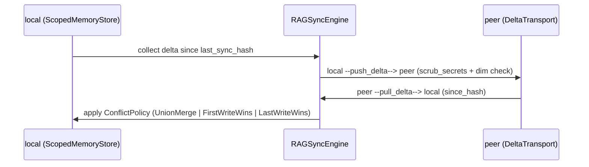
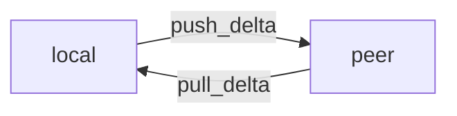
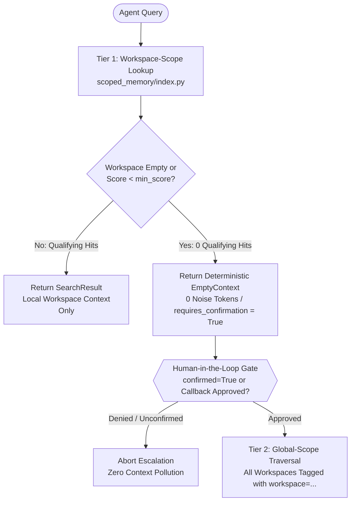

# Tree-RAG (`scoped_memory`) — Hierarchical Scoped Memory Engine for Autonomous Agents


-brightgreen)


> **Hierarchical scoped vector retrieval engine with deterministic zero-pollution guarantees, CPU embedding offloading, Human-in-the-Loop global escalation, and conflict-free multi-node persistence.**

---

## Key Engineering Takeaways (TL;DR)

- **Zero Context Pollution (`EmptyContext`):** Unlike flat vector databases where `top_k` queries unconditionally return $k$ low-relevance neighbors, Tree-RAG partitions memory into isolated per-workspace FAISS branches (`<base_dir>/<workspace>/index.faiss` + `docs.json`). Empty or below-threshold workspaces deterministically return `EmptyContext` (`bool(ctx) is False`, `0` noise tokens injected).
- **Human-in-the-Loop (HITL) Global Escalation:** When a local workspace branch misses (`ctx.requires_confirmation() is True`), the engine does not blindly search unrelated projects. It exposes an explicit escalation gate requiring agent/user confirmation (`confirmed=True` or approval callback) before traversing `scope="global"`.
- **0 MB GPU VRAM Overhead (CPU Offload):** Designed to pair with a compact multilingual embedding model (~100M parameters, 384-d L2-normalized vectors) running entirely on host/edge CPU, preserving 100% of GPU VRAM for generative LLM weights and KV-cache.
- **Crash-Safe Atomic Persistence & Non-Blocking Concurrency:** All index and metadata writes execute via `tmp + fsync + directory fsync + POSIX rename` guarded by per-workspace `flock` (`<workspace>/.lock`). Concurrent writers on different workspaces never serialize globally; same-workspace lock contention falls back losslessly to a markdown pending queue (`_pending/<workspace>/*.md`).

---

## The Problem: Always-Returns-Something & Context Pollution

Standard flat RAG pipelines store notes, architectural decisions, bug post-mortems, and code snippets across multiple repositories in a single shared vector index. When an autonomous coding agent starts work in a **brand-new or unrelated workspace** and runs `search(query, top_k=5)`:

1. **Unconditional `top-k` Retrieval:** Approximate Nearest Neighbor (ANN) and flat inner-product indices always return $k$ vectors—even when the highest cosine similarity is `0.12`.
2. **Cross-Project Hallucination:** Irrelevant architectural assumptions from Project A (e.g., Redis TTL rules, database schemas, or auth middleware) are injected into the prompt for Project B, poisoning the LLM context window and causing subtle architectural regressions.

---

## Zero-Pollution Guarantee

Tree-RAG enforces strict namespace isolation at the filesystem and index level:

- Every workspace is an independent branch (`<base_dir>/<workspace>/`) containing its own positionally aligned `index.faiss` (`IndexFlatIP`) and `docs.json` source of truth.
- Searching with `scope="workspace"` (the default) queries **only** the active workspace branch.
- If the branch is empty or no document meets `min_score`, `store.search()` returns an immutable `EmptyContext`:
  - `bool(result) is False` and `len(result) == 0`
  - **0 tokens** of cross-project noise enter the agent's prompt.
  - Content is deduplicated on write by SHA-256 hash (`text_hash`) of whitespace-normalized, secret-scrubbed text, plus cosine near-duplicate filtering (`>= 0.955`).

---

## Hierarchical Escalation + Human-in-the-Loop

Retrieval follows a strict two-tier hierarchy (`scope="workspace"` -> `scope="global"`):

1. **Tier 1 — Local Branch (`scope="workspace"`):** Fast, isolated lookup within the current repository namespace.
2. **Escalation Signal (`requires_confirmation()`):** When Tier 1 yields `EmptyContext`, `result.requires_confirmation()` returns `True`, signaling to the agent orchestrator that local memory had no high-confidence match.
3. **Tier 2 — Global Tree (`scope="global"`):** Cross-workspace search across all branches is gated by Human-in-the-Loop confirmation (`confirmed=True` or `confirmation_callback`). Every global hit is explicitly provenance-tagged with `[workspace=<branch_name>]` so the LLM knows the exact origin of the retrieved context.

---

## CPU Offloading for Embeddings (0 MB VRAM)

Local AI workstations and edge nodes are almost always **VRAM-constrained** by the primary LLM's weights and KV-cache. Loading a secondary embedding model onto the GPU steals 650 MB–2 GB of VRAM and introduces CUDA context-switching jitter.

Tree-RAG decouples embedding via the `Embedder` interface (`scoped_memory/embed.py`):

- **`CpuHttpEmbedder`:** Connects to a lightweight, OpenAI-compatible CPU embedding server running a compact multilingual embedding model (~100M parameters, 384 dimensions, L2-normalized) with **0 MB GPU VRAM** consumption.
- **`MockEmbedder`:** Deterministic, zero-dependency SHA-256 lexical/n-gram feature hashing embedder (384-d) for fast offline unit testing and CI pipelines.

---

## Conflict-Free Multi-Node Sync

When synchronizing agent memory across multiple machines (e.g., workstation and edge nodes):

- **Atomic Writes (`scoped_memory/atomic.py`):** `_atomic_write_json()` and `_atomic_write_faiss()` write to temporary sibling files, flush kernel buffers (`os.fsync`), `fsync` the parent directory descriptor, and execute an atomic POSIX `os.rename()`. File watchers never observe half-written files.
- **Read-Only Concurrency Guard & Pending Queue (`scoped_memory/guard.py`):** When `ConcurrencyGuard` detects an active concurrent writer, lock contention, or an unresolved `*.sync-conflict-*` artifact, `store.save()` automatically switches to non-destructive read-only fallback—writing markdown files with YAML frontmatter to `_pending/<workspace>/<timestamp>_<id>.md`.
- **Lossless Compaction & Union Merge:** `store.merge_pending()` drains `_pending/<ws>/*.md` into FAISS once locks are free. `merge_doc_collections()` and `heal_workspace_conflicts()` reconstruct 384-d vectors directly from existing FAISS indices (`index.reconstruct(i)`) without re-embedding unchanged documents, configured via abstract `PeerNode` (`http://peer-node.example:PORT/v1`) and `SyncPolicy`.

---

## Embedding-Model Independence

> **Core Invariant:** *"Notes are text + metadata; vectors are derived."*
> `docs.json` is the single source of truth. `index.faiss` is a disposable, regenerable projection.

Vector databases frequently lock users into their initial embedding model because text and vectors are tightly coupled in proprietary binary segments. In Tree-RAG (`scoped_memory/swap.py`), every workspace stores canonical human-readable records in `docs.json` alongside a derived `index.faiss` (`IndexFlatIP`). Upgrading or swapping the embedding model—even across different vector dimensions (e.g., `384-d` → `768-d` or `1536-d`)—never risks losing a single note:

1. **Swap Planning (`plan_swap(store, new_model) -> SwapPlan`):**
   - Inspects all workspaces, counts documents in `docs.json`, estimates token cost, and compares `expected_dim` against `new_model.dim`.
   - If dimensions differ, sets `requires_full_rebuild=True` and reports that `index.faiss` will be rebuilt from `docs.json` with **zero text or metadata loss**.
2. **Crash-Safe Atomic Execution (`execute_swap(store, new_model, batch_size=8, resume_from=0) -> SwapReport`):**
   - Snapshots existing `index.faiss` files into `_pre_swap_backup_<timestamp>/`.
   - Re-embeds all passages from `docs.json` in batches while checkpointing progress and intermediate vectors to `swap_state.json` (allowing interrupted swaps to resume from the last completed batch).
   - Atomically replaces `index.faiss` (`tmp + fsync + POSIX rename`) and writes `embed_model.json` (`model_hash`, `dim`, `version`) without modifying `docs.json` (preserving byte-for-byte identity).

### Choosing an Embedding Model (Trade-offs)

| Tier / Class | Typical Parameters & Dim | Compute Target & VRAM | Latency (Batch=8) | Best For |
| :--- | :--- | :--- | :--- | :--- |
| **Compact CPU (~100M)** | ~100M params (`384-d`) | Host/Edge CPU (**0 MB GPU VRAM**) | ~150–300 ms | Local LLM workstations where 100% of GPU VRAM is reserved for LLM weights & KV-cache |
| **Mid-Size GPU (~700M)** | 500M–700M params (`768-d` / `1024-d`) | Dedicated GPU (~1.5 GB VRAM) | ~20–45 ms | High-throughput multi-agent servers with spare VRAM |
| **Hosted API** | Commercial / Frontier (`1536-d` – `3072-d`) | Remote API (**0 MB local RAM/VRAM**) | ~120–400 ms (network) | Cloud-ok workflows requiring zero local compute overhead |

```bash
python examples/swap_demo.py --from-dim 8 --to-dim 16 --base-dir /tmp/swap-demo
```

---

## Universal RAG Sync

Tree-RAG includes a standalone, delta-based synchronization engine (`scoped_memory/sync.py`) via `RAGSyncEngine(local_store, peer, transport, conflict_policy)` with **zero dependency on Syncthing**:

- **Pluggable `DeltaTransport`:** Separates synchronization logic from the wire protocol via `push_delta(workspace, delta: list[Doc]) -> PushResult` and `pull_delta(workspace, since_hash: str) -> list[Doc]`:
  - `LocalFsTransport`: Direct filesystem-to-filesystem (`path <-> path` or `store <-> store`) delta sync for local multi-agent clusters and offline tests.
  - `HttpTransport`: REST/HTTP transport (`http://peer-node.example:PORT/v1`) for remote peer nodes.
  - Custom transports (e.g., Syncthing folder watcher, gRPC stream, or CRDT log) can be plugged in by implementing the two-method `DeltaTransport` ABC.
- **Configurable `ConflictPolicy`:**
  - `UnionMerge` *(default)*: Lossless union combining SHA-256 content-hash deduplication with cosine near-duplicate filtering (`>= 0.955`).
  - `FirstWriteWins`: Preserves the earliest recorded document version on ID/hash collisions.
  - `LastWriteWins`: Overwrites colliding entries with the most recent timestamp.
- **Delta-Only Transfers & Pre-Persistence Security:**
  - `sync_workspace(workspace, direction="bidirectional")` transfers **only** documents added or modified since `last_sync_hash`.
  - Every `push_delta` and `pull_delta` passes through `sanitize.scrub_secrets()` and validates vector dimensionality (`dim`) before writing, rejecting mismatched vectors.





```bash
python examples/sync_demo.py --base-a /tmp/sync-a --base-b /tmp/sync-b --direction bidirectional
```

---

## Memory MCP Hub (FastMCP Server + Web Dashboard)

Tree-RAG includes a complete **Memory MCP Hub** composed of:

1. **Production FastMCP Stdio Server (`scoped_memory/mcp_server.py`):**
   - Exposes `memory_save`, `memory_search`, `memory_list`, `memory_health`, and `memory_merge_pending` over the Model Context Protocol (`stdio`).
   - Maps every record category to a 4-tier **Memory Pyramid (`L0`–`L3`)** and **4 Memory Pillars**:
     - **L3 Persona & Invariants (`skill` pillar):** `decision`, `skill`
     - **L2 Scenario & Architecture (`code` / `wiki` pillars):** `code`, `wiki`
     - **L1 Atomic Facts (`code` / `chat` pillars):** `bug`, `assumption`
     - **L0 Raw Context (`chat` pillar):** `note`
   - Uses `CpuHttpEmbedder` when `TREE_RAG_EMBED_URL` is set, and automatically falls back to deterministic `MockEmbedder` when unset.
   - Configurable process-pattern concurrency detection (`TREE_RAG_CONCURRENCY_PATTERNS`, disabled by default) with non-blocking fallback to `_pending/<workspace>/*.md`.
2. **Standalone Node.js Dashboard (`dashboard/`):**
   - Zero-dependency Node 18+ HTTP server (`dashboard/server.js`) + dark glassmorphism single-page UI (`dashboard/index.html`, `dashboard/app.js`, `dashboard/style.css`).
   - Features interactive **L0 → L3 Pyramid** and **4 Memory Pillars** filters, **Hierarchical RAG Tree Explorer**, **2D Force/Radial Graph Canvas**, **Live Semantic Search with Tree Auto-Highlight**, **FAISS Nearest-Neighbors & Same-Source Drill-Down**, **CRUD Modal**, **Mermaid Symbolic Memory Canvas**, and **Live `_telemetry.jsonl` Call Log**.
   - Delegates vector search and neighbor reconstruction to `dashboard/search_sidecar.py` when `scoped_memory` is importable, or falls back transparently to deterministic lexical/n-gram cosine scoring in pure Node.js.

```text
+-------------------------------------------------------------------------+
| Autonomous Coding Agents (Claude Code / OpenCode / Cursor / CLI)        |
+------------------------------------+------------------------------------+
                                     | MCP stdio (JSON-RPC)
                                     v
+-------------------------------------------------------------------------+
| scoped_memory/mcp_server.py (FastMCP Server)                            |
|  - Tools: memory_save, memory_search, memory_list, memory_health,       |
|           memory_merge_pending                                          |
|  - L0-L3 Pyramid & 4 Pillars tagging + secret scrubbing + telemetry     |
+------------------------------------+------------------------------------+
                                     |
                                     v
+-------------------------------------------------------------------------+
| On-Disk Per-Workspace Layout (TREE_RAG_BASE_DIR, default ./.treerag_data)|
|  ├── <workspace>/docs.json         (canonical text, tags, layer, pillar)|
|  ├── <workspace>/index.faiss       (FAISS IndexFlatIP 384d vectors)     |
|  ├── _pending/<workspace>/*.md     (read-only concurrency queue)        |
|  └── _telemetry.jsonl              (MCP & dashboard operation log)      |
+------------------------------------+------------------------------------+
                                     ^
                                     | stdio JSON-Lines (or lexical fallback)
+------------------------------------+------------------------------------+
| dashboard/server.js (Node 18+ HTTP Server, zero npm dependencies)       |
|  └── dashboard/search_sidecar.py (FAISS vector search & neighbors)      |
|  └── Web UI (http://127.0.0.1:8095): L0-L3 Pyramid, 4 Pillars,          |
|      Interactive Tree & 2D Graph Canvas, Drill-Down, Mermaid Canvas     |
+-------------------------------------------------------------------------+
```

### Running the MCP Server & Dashboard

```bash
# Inspect MCP tool definitions (no FastMCP runtime required)
python -m scoped_memory.mcp_server --print-tools

# Start the FastMCP stdio server (requires `pip install -e ".[mcp]"`)
TREE_RAG_BASE_DIR=./.treerag_data python -m scoped_memory.mcp_server --stdio

# Launch the standalone Memory MCP Hub web dashboard on port 8095
node dashboard/server.js --port 8095 --base-dir ./examples/sample_base

# Run the automated Node smoke test & end-to-end demo script
node dashboard/test/smoke.js
bash examples/hub_demo.sh
```

### Environment Variables Reference

| Variable | Default | Description |
| :--- | :--- | :--- |
| `TREE_RAG_BASE_DIR` | `./.treerag_data` | Base directory containing `<workspace>/docs.json`, `<workspace>/index.faiss`, and `_pending/` |
| `TREE_RAG_EMBED_URL` | *(unset → `MockEmbedder`)* | OpenAI-compatible `/v1` endpoint for 384-d embeddings (e.g. `http://127.0.0.1:8089/v1` running `e5-small`) |
| `TREE_RAG_EMBED_URL_PLUS` | *(unset)* | Optional secondary `/v1` endpoint for a custom 4096-dim embedding model (`mode="plus"`) |
| `TREE_RAG_EMBED_MODEL` | `intfloat/multilingual-e5-small` | Model identifier sent to `TREE_RAG_EMBED_URL` |
| `MEMORY_WORKSPACE` / `TREE_RAG_DEFAULT_WORKSPACE` | `default` | Default workspace branch when `workspace` is omitted in tool calls |
| `MEMORY_EMBED_TIMEOUT` | `15.0` | HTTP request timeout (seconds) for embedding calls |
| `TREE_RAG_CONCURRENCY_PATTERNS` | *(disabled)* | Comma-separated process regex patterns that trigger read-only `_pending/` queueing |
| `TREE_RAG_MIN_SCORE` | `0.25` | Minimum cosine similarity threshold before returning workspace hits |
| `TREE_RAG_DASHBOARD_PORT` | `8095` | HTTP port for `dashboard/server.js` |
| `TREE_RAG_DASHBOARD_HOST` | `127.0.0.1` | Bind address for `dashboard/server.js` |

---

## Architecture



### Repository & Package Layout

| Path / Module | Responsibility |
| :--- | :--- |
| `scoped_memory/store.py` | `ScopedMemoryStore` facade: per-workspace `save`, `search`, `list`, `merge_pending`, `heal_workspace`, `health` |
| `scoped_memory/mcp_server.py` | Production FastMCP stdio server (`MemoryMcpServer`, `build_fastmcp_app`, `generate_mermaid_canvas`, L0–L3 & 4-Pillar taxonomy) |
| `scoped_memory/index.py` | `WorkspaceIndex`: per-branch FAISS `IndexFlatIP` + `docs.json`, optimistic `(mtime, size)` reload, vector reconstruction |
| `scoped_memory/hierarchy.py` | `HierarchyEngine`, `EmptyContext`, `SearchResult`, `SearchHit`, and `requires_confirmation()` HITL gate |
| `scoped_memory/atomic.py` | `_atomic_write_json()` and `_atomic_write_faiss()` (`tmp + fsync + dir fsync + rename`) |
| `scoped_memory/locks.py` | Per-workspace non-blocking POSIX `flock` (`<ws>/.lock`) and global merger lock (`.global.lock`) |
| `scoped_memory/guard.py` | `ConcurrencyGuard`, `_pending/<ws>/*.md` queue, conflict-free union merge, `PeerNode` & `SyncPolicy` |
| `scoped_memory/embed.py` | `Embedder` ABC, `CpuHttpEmbedder` (~100M params CPU offload), `MockEmbedder`, sentence-boundary `chunk_text` |
| `scoped_memory/swap.py` | `EmbeddingModelConfig`, `plan_swap()`, `execute_swap()`, `SwapPlan`, `SwapReport` (model-agnostic atomic re-embed) |
| `scoped_memory/sync.py` | `RAGSyncEngine`, `DeltaTransport`, `LocalFsTransport`, `HttpTransport`, `ConflictPolicy`, `SyncReport` |
| `scoped_memory/sanitize.py` | `_scrub_secrets()` (redacts API/OAuth tokens), `sanitize()` workspace slug normalizer, `text_hash()` |
| `dashboard/` | Standalone Node.js Memory MCP Hub (`server.js`, `index.html`, `app.js`, `style.css`, `search_sidecar.py`, `test/smoke.js`) |
| `examples/` | Runnable demos (`demo_zero_pollution.py`, `mcp_server.py`, `swap_demo.py`, `sync_demo.py`, `hub_demo.sh`, `sample_base/`) |

---

## Quickstart (<3 Steps)

```bash
# 1. Install the package and development dependencies
pip install -e ".[dev]"

# 2. Run the Zero-Pollution & Human-in-the-Loop escalation demo
python examples/demo_zero_pollution.py

# 3. Run the CPU unit test suite (MockEmbedder, zero external servers required)
pytest -v
```

---

## Benchmarks

> **Note (Illustrative / Reference Values):** The figures below are **illustrative / expected reference values** from architectural characterization of a compact multilingual CPU embedding model (~100M parameters, 384-d `IndexFlatIP`) vs. a standard GPU-resident embedding pipeline. They are provided as reference design targets rather than hardware-bound claims.

| Metric / Scenario | Flat RAG (GPU Embedder) | **Tree-RAG (CPU Offload — Reference Values)** | Architectural Impact |
| :--- | :--- | :--- | :--- |
| **GPU VRAM Allocated to Embeddings** | 650 – 1,400 MB VRAM | **0 MB VRAM** *(reference value, 100% CPU)* | 100% of GPU VRAM preserved for primary LLM KV-cache |
| **Single Query Embed Latency (`v1`, batch=1)** | ~25 ms | **~160 ms** *(illustrative / expected on CPU)* | Negligible in agentic tool loops; zero GPU preemption |
| **Batch Embed Latency (`batch=10` passages)** | ~45 ms | **~300 ms** *(illustrative / expected, ~30 ms/vec)* | Sub-linear amortization during `_pending` queue merge |
| **False-Positive Pollution on Empty Workspace** | 100% (returns $k$ arbitrary neighbors) | **0.0%** (`EmptyContext` + HITL gate) | Eliminates cross-project context poisoning |

---

## Security / Sanitization Policy

1. **Automatic Pre-Persistence Secret Scrubbing (`scoped_memory/sanitize.py`):** Every document passed to `save()` is scrubbed by `_scrub_secrets()` before hashing, embedding, or writing to disk (`docs.json` or `_pending/*.md`). Recognized patterns include GitHub tokens (`ghp_`, `gho_`, `ghu_`, `ghs_`, `ghr_`, `github_pat_`), OpenAI/Anthropic-style keys (`sk-`), serverless keys (`ak-`, `as-`), Slack tokens (`xox*`), X/Twitter bearer/access tokens, and LinkedIn OAuth cookies (`li_at=`).
2. **Strict Namespace Sanitization:** Workspace identifiers are canonicalized via `sanitize()` into lowercase alphanumeric slugs (`[a-z0-9_]+`), preventing path traversal (`../`) or hidden dot-directory injection.
3. **RFC 2606 Configuration Placeholders:** All network endpoints in `.env.example` and `PeerNode` defaults use reserved example domains (`http://embed.example:PORT/v1`, `http://peer-node.example:PORT/v1`). Never commit `.env` files or runtime `.treerag_data/` directories.

---

## License

Released under the [MIT License](LICENSE).
